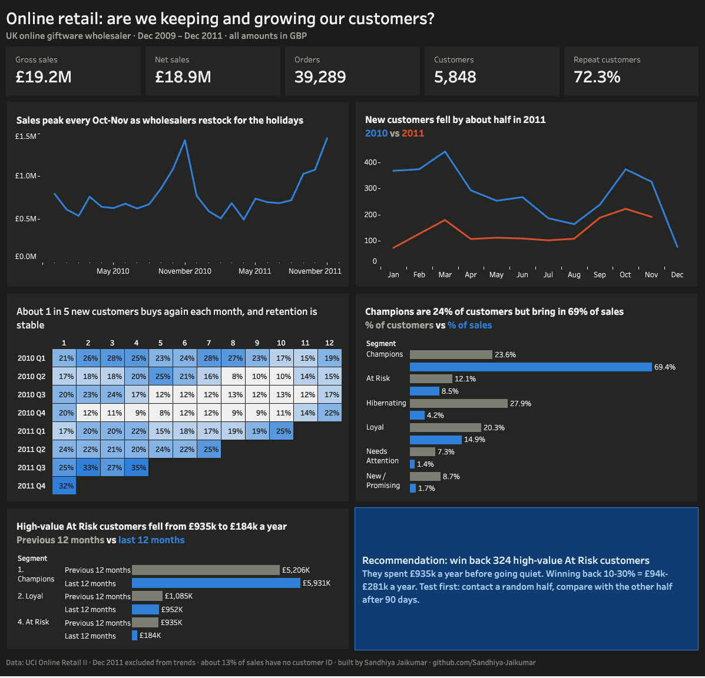
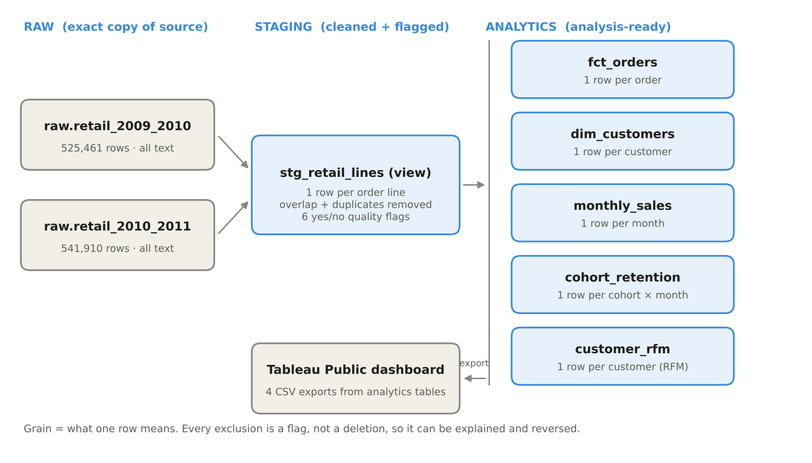

# Online Retail: Customer Retention & Revenue Analytics

**Business question:** Which customers drive revenue, are we keeping them, and where should the sales team focus next quarter?

**Answer:** Retention is stable, but new-customer acquisition roughly halved in 2011, and 324 high-value customers who used to spend **£935k a year** have gone quiet. A win-back campaign, run as a controlled test, is worth an estimated **£94k–£281k a year**.

📊 [Interactive dashboard](https://public.tableau.com/app/profile/sandhiya3216/viz/OnlineRetail-CustomerRetentionRevenue/CustomerRetentionRevenue) · 📄 [Executive memo](docs/executive_memo.pdf) · 🧹 [Data quality log](docs/data_quality_log.md) · 🧾 [Project brief and metric definitions](docs/project_brief.md) · 💻 [SQL](sql/)

---

# Project Background

A UK-based online giftware retailer that sells mainly to wholesale (business) customers. This project uses **real, messy transaction data**: 1,067,371 order lines from Dec 2009 to Dec 2011 ([UCI Online Retail II](https://archive.ics.uci.edu/dataset/502/online+retail+ii)). All amounts are in British pounds (£).

The analysis is written for a **Head of Sales** deciding where to focus next quarter, and answers three executive questions:

1. **Are we keeping the customers we win?**
2. **Which customers drive our revenue, and which valuable ones are slipping away?**
3. **Where should we focus next quarter, and what is it worth?**

Insights and recommendations cover these areas:

- **Sales trends and seasonality**
- **Customer acquisition and retention**
- **Customer segments (RFM)**
- **Win-back opportunity and impact sizing**

Every metric is defined before analysis in the [project brief](docs/project_brief.md), so the dashboard and memo use identical numbers.

---

# Data Structure & Initial Checks

The data was loaded into **Google BigQuery** and modeled in three layers with SQL. Raw data is loaded as text so no row can fail or be silently changed; types are fixed in SQL, where every fix is written down.

| Layer | Table | Grain (one row per…) |
|---|---|---|
| Raw | `raw.retail_2009_2010`, `raw.retail_2010_2011` | Source row, unchanged |
| Staging | `staging.stg_retail_lines` (view) | Order line, typed and flagged |
| Analytics | `fct_orders` | Order |
| Analytics | `dim_customers` | Customer |
| Analytics | `monthly_sales` | Month |
| Analytics | `cohort_retention` | Cohort month × months since first order |
| Analytics | `customer_rfm` | Customer, with RFM scores and segment |

**Data quality checks performed** (full detail in the [data quality log](docs/data_quality_log.md)):

- **Overlapping files:** both yearly files contain Dec 1–9, 2010. Removed 22,523 double-counted rows by taking that period from one file only.
- **Exact duplicates:** removed 11,812 repeated lines (assumed system double-entries).
- **Reconciliation:** the audit found 34,335 duplicate rows and cleaning removed exactly 34,335, which proves the overlap rule removed only true copies.
- **Same-day reversals:** 1,969 sale lines (£557k) were placed and fully cancelled the same day, including one 80,995-unit order worth £168k. Removed from both sides; otherwise two customers would have ranked as top spenders who kept nothing.
- **Non-product codes:** postage, fees, manual adjustments, test items and gift vouchers excluded using a reviewed list. My first pattern-based rule wrongly caught real products, so I replaced it.
- **Cancellations:** fee reversals were mixed in with product cancellations. Product cancellations only: −£327,733 (1.7% of gross sales).
- **Missing customer IDs:** 22.6% of valid sale lines. Kept in revenue, excluded from customer analysis.
- **Row-level flags, not deletions:** every exclusion is a yes/no column in the staging view, so it can be explained and reversed.
- **Totals reconcile** across staging, order and monthly tables (£19,195,880.05 in all three).

---

# Executive Summary

### Overview of Findings

1. **We keep customers, but we're winning far fewer.** 73% of new customers buy again, and 2011 joiners return as often as 2010 joiners. But new customers fell 49–66% in 2011, and 82% of 2011 known-customer sales came from customers won before 2011.
2. **Revenue is highly concentrated.** Champions (24% of customers) bring in 69% of known-customer sales, and the top 1% of customers bring in 31%.
3. **A clear, sized opportunity.** 324 high-value At Risk customers dropped from £935k to £184k in yearly sales. Winning back 10–30% of that is worth £94k–£281k a year.

| Gross sales | Net sales | Orders | Customers | Repeat customers |
|---|---|---|---|---|
| £19.2M | £18.9M | 39,289 | 5,848 | 72.3% |

---

## Insights Deep Dive

### 1) Sales Trends and Seasonality
- **Strong holiday seasonality.** Sales peak every October–November at about twice a typical month, as wholesalers restock for the holidays.
- **Cancellations are small once cleaned.** Product cancellations are 1.7% of gross sales. A raw view suggested 7.4%, because fee reversals and same-day reversals were mixed in.
- **Dec 2011 is excluded from trends**, since it has only 9 days of data.

### 2) Customer Acquisition and Retention
- **Retention is steady.** About 1 in 5 new customers buys in any given month after joining, with a bump at month 12 as customers return for the next holiday season.
- **Retention did not decline.** A first comparison suggested 2011 joiners returned less often. Retesting on a cleaner season (Jun–Aug cohorts) showed month-3 retention of 26.5% (2010) vs 26.9% (2011). The first gap came from the data starting in Dec 2009.
- **Acquisition is the real problem.** New customers fell 66% (Jan–May) and 49% (Jun–Aug) in 2011 vs 2010, while revenue was increasingly carried by older customers.

### 3) Customer Segments (RFM)

| Segment | % of customers | % of sales | Avg orders | Avg days since last order |
|---|---|---|---|---|
| Champions | 23.6% | 69.4% | 16.2 | 19 |
| Loyal | 20.3% | 14.9% | 5.6 | 75 |
| At Risk | 12.1% | 8.5% | 5.5 | 358 |
| Hibernating | 27.9% | 4.2% | 1.3 | 452 |
| New / Promising | 8.7% | 1.7% | 1.5 | 27 |
| Needs Attention | 7.3% | 1.4% | 1.4 | 106 |

- **Champions are healthy and growing:** +14% year over year among high-value Champions.
- **Concentration risk:** top 1% of customers = 31.1% of sales; top 20% = 76.7%.

### 4) Win-Back Opportunity
- **324 high-value At Risk customers** spent £935,383 in the previous 12 months and only £184,077 in the last 12 months.
- They used to order 5–6 times on average and are known accounts the sales team can contact directly.

### 5) Data Gap: Untracked Revenue
- **13.1% of sales have no customer ID.** These orders are large (77.6 lines on average vs 21.2), so a meaningful share of revenue can't be tracked, retained or won back.

---

## Recommendations
- **Win back high-value At Risk customers (recommended).** Estimated £94k–£281k a year (10–30% of former spend). Test first: split the 324 customers randomly into two groups of 162, contact one, and compare reorder rate and sales after 90 days.
- **Rebuild new-customer acquisition (next priority).** A new customer is worth about £1,487 in their first year (upper estimate).
- **Protect Champions** with account management to reduce concentration risk.
- **Capture a customer ID on every order** to make about 13% of revenue trackable.

The full reasoning, options compared and risks are in the [one-page executive memo](docs/executive_memo.pdf).

---

## How It's Built

| Step | Tool | File |
|---|---|---|
| Data audit | BigQuery SQL | [`sql/01_data_audit.sql`](sql/01_data_audit.sql) |
| Cleaned, flagged view | BigQuery SQL | [`sql/02_stg_retail_lines.sql`](sql/02_stg_retail_lines.sql) |
| Cleaning checks | BigQuery SQL | [`sql/03_cleaning_checks.sql`](sql/03_cleaning_checks.sql) |
| Analytics tables | BigQuery SQL | [`sql/04_analytics_tables.sql`](sql/04_analytics_tables.sql) |
| Analytics checks | BigQuery SQL | [`sql/05_analytics_checks.sql`](sql/05_analytics_checks.sql) |
| Cohort retention | BigQuery SQL | [`sql/06_cohort_retention.sql`](sql/06_cohort_retention.sql) |
| RFM segments and opportunity sizing | BigQuery SQL | [`sql/07_rfm_segments.sql`](sql/07_rfm_segments.sql) |
| Exports for the dashboard | BigQuery SQL | [`sql/08_exports_for_tableau.sql`](sql/08_exports_for_tableau.sql) |
| Dashboard | Tableau Public | [Live dashboard](https://public.tableau.com/app/profile/sandhiya3216/viz/OnlineRetail-CustomerRetentionRevenue/CustomerRetentionRevenue) |

Each SQL file starts with a one-line note saying when to run it.

**Methods:** data quality auditing and reconciliation, dimensional modeling (fact and dimension tables), cohort retention with a full cohort × month grid (so months with zero buyers count as zero), RFM segmentation using `PERCENT_RANK` (so tied customers get the same score), weighted retention rates, and scenario-based impact sizing.

### Reproduce it
1. Download the data from [UCI](https://archive.ics.uci.edu/dataset/502/online+retail+ii) and save each Excel sheet as a CSV.
2. In the free BigQuery sandbox, load both CSVs into a `raw` dataset with every column as text (`STRING`) and 1 header row skipped.
3. Replace `retail-portfolio-513601` with your project ID and run the SQL files in order (01 → 08).

The raw data isn't stored in this repository because of its size.

---

## Future Work
- Rebuild the SQL layers in **dbt** with automated tests and lineage documentation.
- Add **k-means clustering** to validate the RFM segments.
- Add a **monthly revenue forecast** with a backtest against held-out months.
- Analyze the **A/B test results** once the win-back campaign runs.

---

## Assumptions and Caveats
- Data is from 2009–2011; the methods matter more than the specific period.
- Figures are **sales, not profit**; product costs aren't in the data.
- Exact duplicate lines and same-day reversals are treated as entry errors (assumption). The reversal rule may over-exclude up to about £44k (0.2% of sales).
- Customers first seen in Dec 2009 may be long-time customers, because the data starts that month; they're excluded from retention comparisons.
- Win-back rates in the impact estimate are assumptions until the test measures them.
- Customer analysis excludes sales with no customer ID (13.1% of sales).

---

*Data: Chen, D. (2012). Online Retail II [Dataset]. UCI Machine Learning Repository. CC BY 4.0.*
*Built by Sandhiya Jaikumar · [LinkedIn](https://www.linkedin.com/in/sandhiya-jai) · [GitHub](https://github.com/Sandhiya-Jaikumar)*
