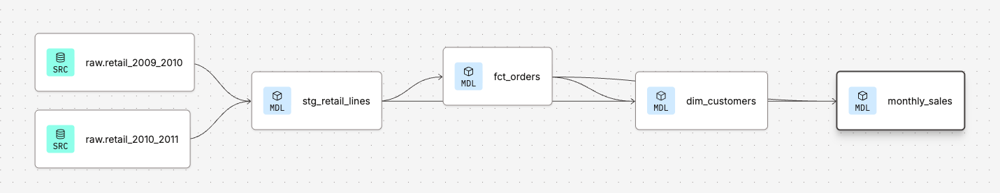

# dbt project: Online Retail Analytics

This folder rebuilds the project's BigQuery SQL pipeline as a **dbt** project, with automated tests and lineage. It runs on the dbt platform against the free BigQuery sandbox.

## Models

| Model | Built as | Grain (one row per…) | What it does |
|---|---|---|---|
| `stg_retail_lines` | View | Order line | Combines both raw files, removes the Dec 1–9, 2010 overlap and exact duplicates, fixes data types, and flags cancellations, non-product codes, invalid rows and same-day reversals |
| `fct_orders` | Table | Order | Valid product sales rolled up to orders |
| `dim_customers` | Table | Customer | First/last order, cohort month, orders, sales and repeat flag |
| `monthly_sales` | Table | Month | Orders, active and new customers, gross sales, product cancellations and net sales |

Staging models are views (no storage cost); analytics models are tables (fast for Tableau).

## Tests (10, all passing)

- **unique** and **not_null** on every primary key (order, customer, month), which proves each table's grain
- **relationships:** every customer on an order exists in `dim_customers`
- **assert_revenue_reconciles:** a custom test that fails if gross sales differ between staging, `fct_orders` and `monthly_sales`, or don't equal the verified £19,195,880.05

## Validation

Every dbt model was compared with the original SQL tables and matches exactly:

| Check | Result |
|---|---|
| Staging rows | 1,033,036 |
| Valid sale lines | 1,001,485 |
| Orders | 39,289 (2,922 with no customer ID) |
| Customers | 5,848 (72.3% repeat) |
| Months | 25 |
| Gross / net sales | £19,195,880.05 / £18,868,146.77 |

`dbt build`: 14 of 14 passed (4 models + 10 tests).

## Files

~~~
dbt/
├── dbt_project.yml                  # project settings: staging = view, marts = table
├── models/
│   ├── staging/
│   │   ├── _sources.yml             # the two raw BigQuery tables
│   │   └── stg_retail_lines.sql
│   └── marts/
│       ├── _marts.yml               # model descriptions and tests
│       ├── fct_orders.sql
│       ├── dim_customers.sql
│       └── monthly_sales.sql
└── tests/
    └── assert_revenue_reconciles.sql
~~~

## Run it

Connect a dbt project to BigQuery, load the raw files into a `raw` dataset (see the main [README](../README.md)), then run:

~~~
dbt build
~~~
